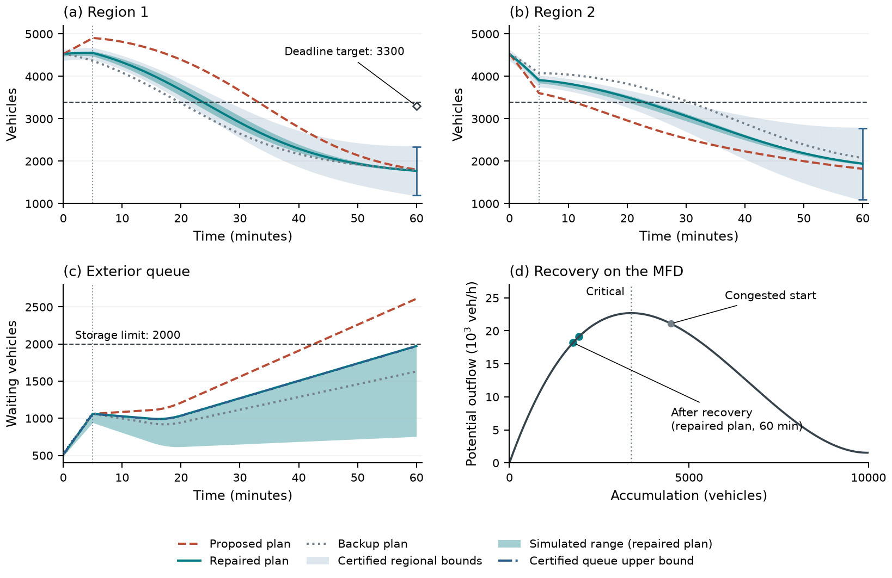

# Agentic perimeter control

Research code for **A Formal Guarantee for Trustworthy Agentic Traffic Control: A Multi-region Perimeter Case**, by **Ali Eslami and Jiangbo Yu**.

[Get started](#quick-start) · [Browse the studies](docs/STUDIES.md) · [Reproduction guide](REPRODUCING.md) · [Paper release](https://github.com/AlienEslami/agentic-perimeter-control-code/releases/tag/paper-2026-11-17)

## What the code does

The framework checks proposed urban perimeter-control plans before implementation. It uses a traffic model based on the macroscopic fundamental diagram (MFD) to bound future regional vehicle counts and exterior queues under initial-state and arrival-forecast uncertainty. A supervisory agent accepts a verified plan, seeks a repaired plan, or continues the current plan when a replacement cannot be verified in time.

The package includes the traffic models, MPC-based planning tools, constraint verification, plan repair, and the saved evidence for the two- and three-region experiments. The numerical planning tools return control schedules; replanning takes place through a newly verified replacement.

## Example: recovery from congestion



The proposed plan reduces regional congestion but overfills the exterior queue in the illustrated simulation. The repaired plan accommodates more entering traffic and satisfies the queue limit and the Region 1 deadline. The shaded bounds cover the repaired plan's specified uncertainty set. [Study details and source files →](docs/STUDIES.md#two-region-recovery)

## Quick start

Use **Python 3.12**. Clone this repository, or [download the current code and records](https://github.com/AlienEslami/agentic-perimeter-control-code/archive/refs/heads/main.zip) and extract the archive.

```sh
git clone https://github.com/AlienEslami/agentic-perimeter-control-code.git
cd agentic-perimeter-control-code
python -m venv .venv
```

Activate the environment using the command for your shell:

| Shell | Command |
|---|---|
| Windows PowerShell | `.\.venv\Scripts\Activate.ps1` |
| Windows Command Prompt | `.venv\Scripts\activate.bat` |
| macOS/Linux | `source .venv/bin/activate` |

Then run:

```sh
python -m pip install -r requirements.txt
python reproduce.py check
python reproduce.py figures
```

- **`check`** restores the saved records, verifies file and certificate hashes, checks reported numerical summaries, and runs a model/interval-arithmetic check with an independent trajectory simulation.
- **`figures`** recreates the two- and three-region recovery plots from saved records. PDF and PNG copies appear in **`output/figures/`**.

These commands run locally without language-model API calls. The bundled records occupy about **88 MiB compressed**. Checking and plotting use the saved experiments; see the [reproduction guide](REPRODUCING.md) for fresh simulations.

## Find the relevant study

| Interest | Start here |
|---|---|
| Congestion recovery and queue protection | [Two-region](docs/STUDIES.md#two-region-recovery) and [three-region](docs/STUDIES.md#three-region-recovery) studies |
| Regional priorities and traffic cost of repair | [Planning and controller comparisons](docs/STUDIES.md#regional-priorities-and-controller-comparisons) |
| State uncertainty and verification bounds | [Coordinates and uncertainty](docs/STUDIES.md#coordinates-and-uncertainty) |
| Replanning and computation delays | [Successive requests and delayed implementation](docs/STUDIES.md#successive-requests-and-delayed-implementation) |
| Agent instructions and tool use | [Agent experiments](docs/STUDIES.md#agent-experiments) |
| Model mismatch and larger networks | [Additional studies](docs/STUDIES.md#additional-studies) |

## Repository structure

| Location | Contents |
|---|---|
| [reproduce.py](reproduce.py) | Entry point for checks, figures and a fresh three-region run |
| [benchmarks/](benchmarks/) | Study drivers, traffic models, planning and verification code, and protocols |
| [scripts/](scripts/) | Record preparation, numerical audits and plotting |
| [data/](data/) | Compressed experimental records and their integrity manifest |
| [docs/STUDIES.md](docs/STUDIES.md) | Links from each study to its implementation and saved evidence |
| `output/figures/` | Recovery plots generated locally; not part of the download |

The existing study paths are retained because stored certificates identify their source files. Dates in these paths identify experiments. The study guide provides topic-based navigation.

## Reproducibility

The manuscript's fixed code snapshot is [release `paper-2026-11-17`](https://github.com/AlienEslami/agentic-perimeter-control-code/releases/tag/paper-2026-11-17). The commands above apply to the current `main` branch, which adds navigation and command-line conveniences around the same numerical code and records. The release contains its own reproduction instructions.

[REPRODUCTION_MANIFEST.json](REPRODUCTION_MANIFEST.json) records the package hashes. [SOURCE_MANIFEST.json](SOURCE_MANIFEST.json) and [PROVENANCE.md](PROVENANCE.md) document the imported research code. The preparation command verifies and restores bundled records without overwriting changed files.

Verification guarantees apply to the specified traffic model and uncertainty bounds. Model-perturbation experiments are identified separately in the study guide. Timing measurements depend on hardware and load.

Saved agent prompts, tool calls and responses are included as experimental evidence. Repeating live agent experiments is optional, requires separate credentials and incurs API charges; see the [agent instructions](REPRODUCING.md#optional-agent-experiments).
